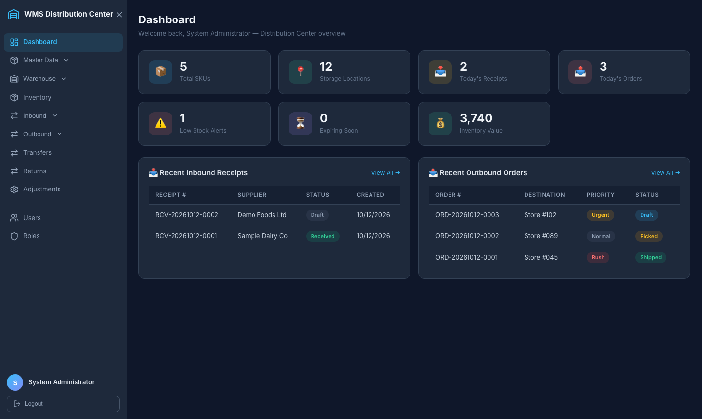
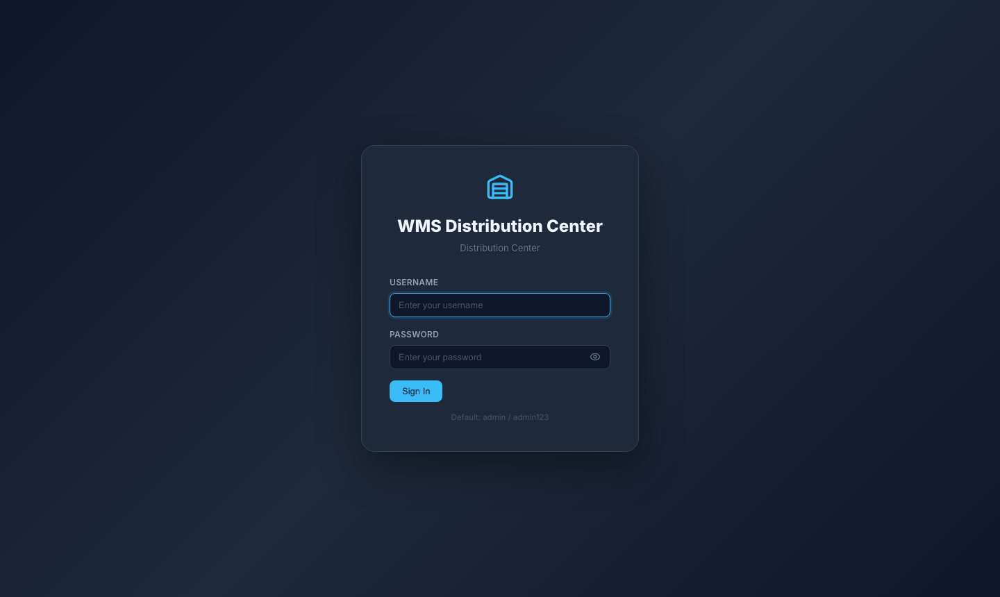
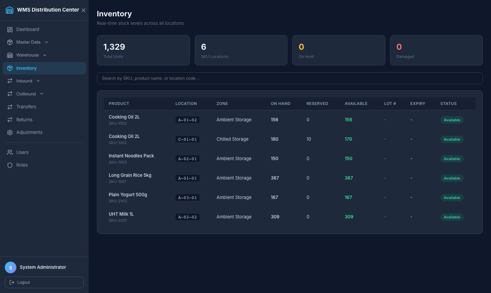
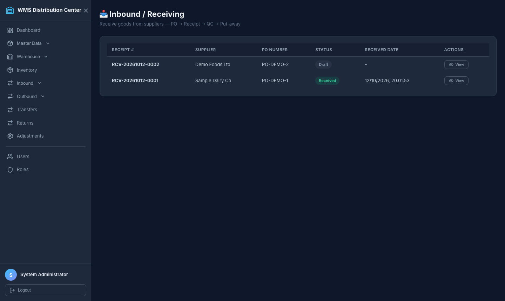
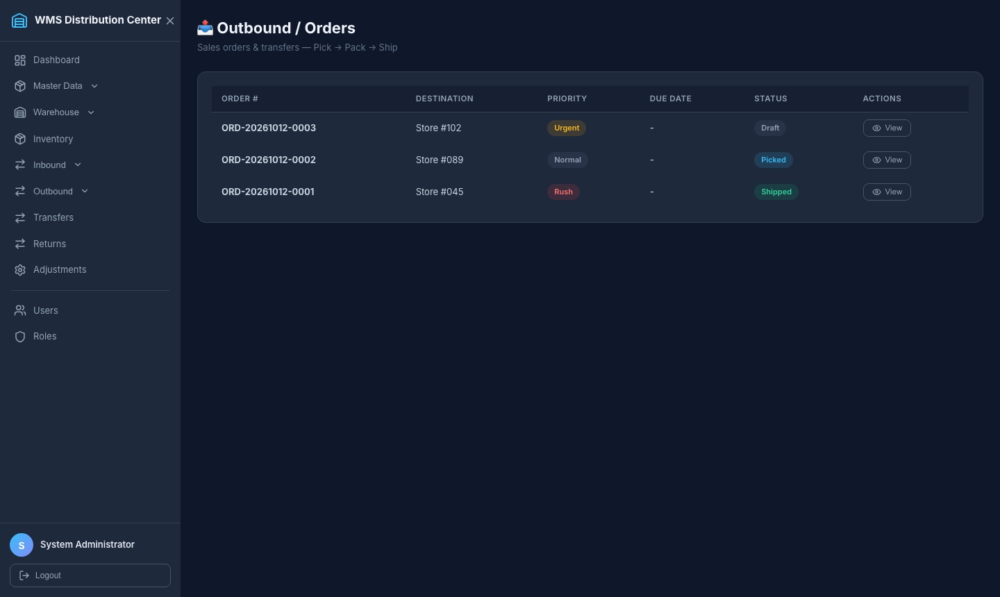

# WMS Distribution Center

A full-stack **Warehouse Management System** for a distribution center: receiving, put-away, inventory control, picking, packing and shipping, with role-based access and a REST API documented in Swagger.

> **Portfolio case study.** This is a personal project built to practise designing a realistic WMS domain model and API. It is not affiliated with any company and ships with fictional demo data only.



## Why

Distribution centers live and die by inventory accuracy. This project models the core inbound-to-outbound flow end to end so the business rules (stock only changes through traceable transactions, shipping requires packing, adjustments need approval) are explicit and tested.

## Features

- **Inbound**: purchase-order receipts, line-level receiving with shortage/damage status, put-away to a location, receipt completion. Re-receiving a line only posts the quantity delta.
- **Inventory**: stock per product and location with on-hand/reserved quantities, an immutable inventory transaction log, and stock adjustments that only apply after approval.
- **Outbound**: sales orders, pick-task generation that reserves stock, packing (cartons), shipping with carrier details. Shipping deducts stock and writes `Out` transactions, and is only allowed for packed orders.
- **Master data**: warehouses, zones, locations, products, categories, units of measure, suppliers, carriers.
- **Security**: JWT authentication, BCrypt password hashing, users and roles; public self-registration always gets the least-privileged `Viewer` role.
- **Reporting**: dashboard KPIs (SKUs, locations, today's inbound/outbound, low stock, expiring soon, inventory value).

### Current scope

The REST API covers all flows above. In the web UI, master data, users and roles have full CRUD; inventory, inbound, outbound and the dashboard are live read views over the API. Creating receipts/orders and the pick/pack/ship steps are done through Swagger for now. Pages for adjustments, picks, shipments, transfers, returns and UOMs are placeholders. Authorization is authentication-only (roles are stored but endpoint-level role checks are not enforced yet).

## Architecture

```
React 19 + Vite  --/api-->  ASP.NET Core 9 Web API  --EF Core-->  PostgreSQL 16
 (axios, router)            Controllers -> Services -> DbContext
                            JWT bearer auth, AutoMapper DTOs, Swagger
```

```
backend/    ASP.NET Core API (Controllers, Services, DTOs, Models, Data/seeder)
frontend/   React SPA (pages, layout, auth context, API client)
tests/      xUnit tests for the core flows
docs/       Specification documents, ERD, Postman collection, screenshots
```

Business logic lives in the services (`InboundService`, `OutboundService`, `InventoryService`, ...) behind interfaces, which is what the tests exercise.

## Tech stack

ASP.NET Core 9, Entity Framework Core 8 (Npgsql), PostgreSQL 16, AutoMapper, JWT bearer auth, BCrypt, Swagger/OpenAPI, React 19, Vite, React Router, Axios, Recharts, xUnit.

## Run it locally

Prerequisites: .NET SDK 9, Node.js 20+, and PostgreSQL 16 (Docker Compose file included).

```bash
# 1. Database
docker compose up -d db            # PostgreSQL on localhost:5432 (db wms_dc, user wms_admin)

# 2. API  -> http://localhost:5243  (Swagger UI at /swagger)
cd backend
dotnet run                         # Development profile: schema is created and demo data seeded

# 3. Frontend -> http://localhost:3000
cd ../frontend
npm ci
npm run dev
```

Sign in with the demo user `admin` / `admin123` (seeded only for local use; change it for anything else).

Configuration is read from `appsettings.json`, `appsettings.Development.json` and environment variables. The committed files contain **no secrets**: outside Development you must provide them yourself.

| Setting | Environment variable | Notes |
|---------|----------------------|-------|
| Database | `ConnectionStrings__DefaultConnection` | Npgsql connection string |
| JWT signing key | `Jwt__Key` | at least 32 characters, app refuses to start otherwise |
| Demo data | `Seed__DemoData` | `true` seeds a fictional warehouse, products and stock |

`appsettings.Development.json` holds clearly marked local-only defaults that match `docker-compose.yml`. Copy `.env.example` to `.env` to change the database credentials used by Compose (then update the connection string to match). If you use a different Postgres, set `ConnectionStrings__DefaultConnection`. The frontend talks to `/api` through the Vite proxy; set `VITE_API_URL` (see `frontend/.env.example`) to point elsewhere.

## Tests

```bash
dotnet test WmsDistributionCenter.sln                # backend: 14 xUnit tests
cd frontend && npm run lint && npm run build        # frontend checks
```

The backend tests use an in-memory database and cover receiving and put-away (including no double counting), receipt completion, pick reservation, pack-and-ship stock deduction, rejecting shipment of unpacked orders, adjustment approval, authentication, the registration role rule, and validity of the whole AutoMapper configuration. CI runs the same commands (`.github/workflows/ci.yml`).

## Screenshots

| Login | Inventory |
|---|---|
|  |  |
| **Inbound** | **Outbound** |
|  |  |

## Known limitations

- AutoMapper 12 has a published advisory; the fixed releases use a commercial license. Fine for a demo, replace it (or map manually) before production.
- CORS is open (`AllowAnyOrigin`) and the schema is created with `EnsureCreated` rather than migrations: both are demo conveniences.
- Role-based endpoint authorization and the remaining UI pages (see Current scope) are not implemented yet.

## Author

**Muhamad Septian Pamungkas**: [github.com/seppam](https://github.com/seppam)

Released under the MIT License.
