# WMS Distribution Center

A full-stack **Warehouse Management System** for a distribution center. It covers the whole physical cycle: receiving and put-away, stock control, order allocation, picking, packing, shipping, adjustments, transfers and returns, with role-based access and a REST API documented in Swagger.

> **Portfolio case study.** A personal project built to practise designing a realistic WMS domain model, API and UI. It is not affiliated with any company and ships with fictional demo data only.

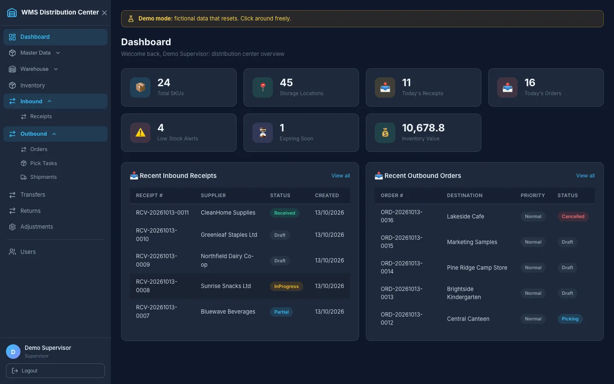

## Try it

Everything below runs a **demo**: fictional data, one shared public account per role, and one-click sign-in buttons on the login page. Nothing to sign up for, no secrets to create.

### Browser demo: no Docker, no database, no host

The whole app runs **inside your browser**: the business rules are reimplemented in TypeScript and the data lives in `localStorage`. No API, no PostgreSQL, no Docker, no network calls. You only need Node.js 20.19+ or 22+.

```bash
git clone https://github.com/seppam/wms-distribution-center
cd wms-distribution-center/frontend
npm ci
npm run dev:browser-demo          # http://localhost:5173
```

Or build the static site and serve it with any static file server (the folder needs a single-page-app fallback to `index.html`, which `vite preview` provides):

```bash
npm run build:browser-demo        # static files in frontend/dist-browser-demo
npm run preview:browser-demo      # http://localhost:5176
```

Click *Sign in as Admin / Supervisor / Operator / Viewer*. A banner says *Browser demo: data is stored only in this browser (localStorage); nothing is sent to a server*, with **Reset demo data** and **About this demo** buttons. A hosted copy can be added: see [Hosting](#hosting-the-real-thing). Differences from the full stack: [The situation and your options](#the-situation-and-your-options).

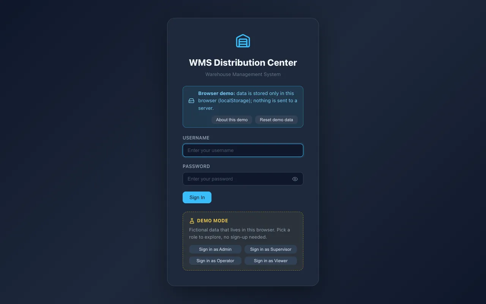
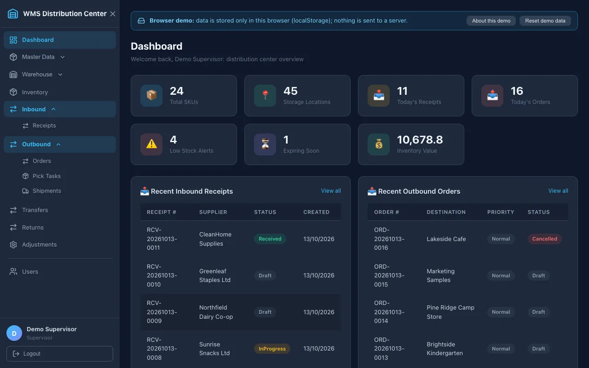

### Full-stack demos (real API and database)

| Option | You need | Command / link | Opens at |
|---|---|---|---|
| **Browser demo** (no Docker, no database) | Node 22 | `cd frontend && npm ci && npm run dev:browser-demo` | <http://localhost:5173> |
| **Docker, one command** (recommended) | Docker with Compose v2 | `git clone https://github.com/seppam/wms-distribution-center && cd wms-distribution-center && docker compose -f docker-compose.demo.yml up --build` | <http://localhost:5174> |
| **GitHub Codespaces**, nothing installed | a GitHub account | [](https://codespaces.new/seppam/wms-distribution-center) | the forwarded port **5174** opens automatically |
| **Without the full Docker stack** | .NET SDK 9, Node 22 (20.19+), Docker only for the database | `./scripts/demo.sh` | <http://localhost:5173> |
| **Local development** | .NET SDK 9, Node 22, Docker for the database | see [Run it locally](#run-it-locally) | <http://localhost:5173> |

- First start builds three images and seeds the data: allow 2-4 minutes (5-8 in Codespaces; open the *Ports* tab and click port 5174 when it is ready).
- **Demo accounts**: `admin`, `supervisor`, `operator`, `viewer`, all with the public demo password `Demo!Pass123`. The login page shows a **Demo mode** panel with *Sign in as Admin / Supervisor / Operator / Viewer* buttons. The panel and the *Demo mode: fictional data that resets* banner only appear when the API reports demo mode (`GET /api/demo-info`, a boolean plus role names, never a password). The normal `docker-compose.yml` never creates demo accounts.
- **Reset**: Admin, banner button *Reset demo data* (confirmation, rate limited, Admin only, 404 outside demo mode), or from a terminal `./scripts/reset-demo.sh` (same as `docker compose -f docker-compose.demo.yml run --rm api --reset-demo`; with `scripts/demo.sh` running use `./scripts/demo.sh --reset`). `docker compose -f docker-compose.demo.yml down -v` starts completely from scratch.
- The demo dataset: 24 SKUs in 6 categories with 4 units of measure, 2 warehouses (45 bins in zones: receiving, ambient and chilled storage, packing, shipping, returns), 6 suppliers, 4 carriers, 11 receipts (draft, in progress, partial, received), 16 outbound orders in **every** state (draft, allocated/picking, picked, packed, shipped, delivered, cancelled; the order *destination* is the customer), adjustments (pending, approved, rejected), transfers (draft, done, cancelled) and returns (awaiting inspection, restocked, disposed, written off). It is built by driving the real services, so stock, reservations and the movement ledger are consistent.

### Try it in 3 minutes

After `docker compose -f docker-compose.demo.yml up --build`, open <http://localhost:5174> and follow this order (every step is also exercised by `frontend/e2e/demo/demo.spec.js`):

1. **Look around as Supervisor**: click *Sign in as Supervisor*. The dashboard shows 4 low-stock alerts and 1 expiring lot. Open **Inventory** (on-hand vs reserved per bin, tab *Movement ledger*).
2. **Receive stock**: *Inbound > Receipts*, open the **Draft** receipt `PO-2413` (Northfield Dairy), press *Receive* on each line (the put-away bin is pre-filled), then *Complete receipt*. It turns *Received* and the stock appears in the ledger.
3. **Allocate an order**: *Outbound > Orders*, open the **Draft** order *Brightside Kindergarten*, press *Allocate stock and start picking*. Stock is reserved first-expiry-first-out and pick tasks appear.
4. **Pick, pack, ship** as Operator: *Logout*, *Sign in as Operator*, *Outbound > Pick Tasks*, *Confirm* each task of that order. Then *Orders*, open it, *Pack* (carton weight) and *Ship* (carrier, tracking number). Finally *Shipments > Mark delivered*. The other orders already sit in every other state to compare.
5. **Adjust**: *Adjustments > New adjustment* (e.g. decrease 2 of any product, give a reason). An Operator can only propose; sign in as Supervisor and *Approve* (nobody but an Admin can approve their own request): stock changes and the ledger records it.
6. **Transfer**: *Transfers*, press *Complete* on the pending move, or *New transfer* to move stock to another bin. Reserved stock cannot be moved.
7. **Return**: *Returns > Receive return* against a delivered order, then as Supervisor *Process* it (restock, refurbish, dispose or write off). Restocked goods return to the bin.
8. **Break it and reset**: sign in as Admin, change anything you like (even delete master data), then press **Reset demo data** in the yellow banner. Try *Viewer* too: every action button is gone, and the API would answer 403 anyway (the reset button exists for Admin only).

**What each role can do**: see the [permission matrix](#roles-and-permission-matrix) below (enforced by the API for every endpoint, tested by `AuthorizationMatrixTests`). In short: Viewer reads; Operator does floor work (receive, pick, pack, ship, adjust, transfer, returns); Supervisor also plans orders and receipts, approves adjustments and edits master data; Admin also manages users, roles and deletes.

## The situation and your options

**Where this stands.** The app is a portfolio case study. There is no hosted instance and nothing in this repository claims one exists: you run it yourself, or you host it yourself. Two different things can be hosted, and they are not interchangeable.

### (a) What the browser demo is and is not

- **Is**: the real React UI talking to an in-browser engine that implements the same API contract (same routes, JSON, status codes and messages) and the same business rules as the backend: first-expiry-first-out all-or-nothing allocation, no over-allocation, over-pick rejection and short picks, pack/ship/deliver, approvals for adjustments, transfers, returns, the four roles and the permission matrix. The matrix and the seed dataset are single contract files in [`contracts/`](contracts) that the backend tests and the frontend tests both assert against, so the two implementations cannot drift silently (`UPDATE_CONTRACTS=1 dotnet test --filter Contract` regenerates them from the real backend).
- **Is not**: a server. One user, one browser, one device: data is per browser profile, clearing site data wipes it, a private window starts fresh. No real authentication (picking a role is the login), no JWT, no PostgreSQL, no migrations, no concurrency between users, no rate limiting, no audit of who did what beyond the ledger. It is a simulation to let anyone try the product, not a deployment of the backend.
- **Known differences from the real backend**: document numbers skip a number that is already taken (the backend would answer 409 and ask to retry); foreign-key and unique-key violations return the same 409 message, but only the constraints listed in the code are modelled; self-registration is always off; enum filters and validation messages follow the API's wording but not every ASP.NET model-binding edge case; timestamps use the browser clock.
- Storage: one JSON document under the key `wms-browser-demo:v1` (about 0.1 MB at start; the 5 MB `localStorage` limit would take thousands of operations). If the browser refuses a write, the demo keeps working from memory and shows a warning in the banner. A new demo version with a different schema or dataset resets saved data (with a notice) unless a migration exists.

### Hosting the real thing

Honest trade-offs, cheapest first. Prices and free tiers change often: check each provider's current page before relying on them.

**1. Static browser demo on any static host (Vercel, Netlify, GitHub Pages, Cloudflare Pages, any web server).** No server, no database, no secrets. Cost: free tiers are common. Trade-off: it is the simulation above, not the real stack.

```bash
cd frontend && npm ci && npm run build:browser-demo     # output: frontend/dist-browser-demo
```

Upload that folder; no environment variables are needed. It needs a **single-page-app fallback** (every unknown path serves `index.html`), because the router uses real URLs:

- **Vercel**: Output Directory `frontend/dist-browser-demo` (Build Command `cd frontend && npm ci && npm run build:browser-demo`) and one rewrite `/(.*)` to `/index.html` set in the project settings, or in a `vercel.json` you add in your own fork (none is committed here on purpose).
- **Netlify / Cloudflare Pages**: the build already writes `_redirects` with `/* /index.html 200`.
- **GitHub Pages**: the build writes `404.html` (a copy of `index.html`). For a project page served under `/<repo>/`, build with `VITE_BASE_PATH=/<repo>/ npm run build:browser-demo`.
- **nginx / any server**: `try_files $uri /index.html;`.

CI builds this folder on every push and attaches it to the workflow run as the `browser-demo-dist` artifact (nothing is deployed).

**2. The full stack: API container + managed PostgreSQL + static web.** Real ASP.NET API, real database, real authentication, many users. Trade-offs: you operate a server and a database (updates, backups, secrets, abuse), and free tiers sleep, have storage limits, or expire.

- **API**: build `backend/Dockerfile`. Run it on Render, Railway, Fly.io, or a small VPS with `docker compose` (the repository's `docker-compose.yml` already wires the database, API and nginx).
- **Database**: PostgreSQL 16 from Neon, Supabase, Railway or Render (managed, with backups on paid plans), or the compose database on your own VPS.
- **Web**: the normal `npm run build` output on a static host (set `VITE_API_URL` to the API's public URL at build time and list that site in `AllowedOrigins`), or the nginx image from `frontend/Dockerfile`, which proxies `/api` so no CORS is needed.

Environment variables (names only, set them in the host's secret store, never in git):

| Variable | Purpose |
|---|---|
| `ConnectionStrings__DefaultConnection` | Npgsql connection string of the managed database |
| `Jwt__Key` | Signing key, 32+ random characters (`openssl rand -base64 48`); the API refuses placeholders |
| `AllowedOrigins__0` (`__1`, ...) | CORS allow-list: the exact origin(s) of the web app. This is the setting's real name in this project (`Cors__AllowedOrigins` does not exist); leave empty when the proxy serves both |
| `Database__MigrateOnStartup` | `true` on the first deploy so the schema is created; afterwards optional |
| `Seed__AdminPassword` | Creates the first administrator (12+ characters) when no user exists; optional `Seed__AdminUsername`, `Seed__AdminEmail` |
| `Seed__DemoData` | Optional: a small fictional warehouse and products (no demo accounts outside Development) |
| `Demo__Enabled`, `Demo__Password` | Optional public-demo mode of the full stack: four public accounts, the rich dataset, an Admin *Reset demo data* action |

Things to plan for:

- **Public demo of the full stack**: with `Demo__Enabled=true` the accounts and password are public by design and any Admin can reset everything. The reset is rate limited per instance (`Demo__ResetPermitLimit` / `Demo__ResetWindowSeconds`, default 3 per 5 minutes) and nothing resets automatically; add a scheduled reset (cron calling `--reset-demo`) and a login rate limit if you expose it. Never put real data in a public demo.
- **TLS**: terminate HTTPS at the platform (Render, Railway, Fly.io and Vercel/Netlify do) or with a reverse proxy such as Caddy or Traefik on a VPS. The compose stack does not do it.
- **Backups**: managed databases offer snapshots (often paid); on a VPS schedule `pg_dump` to storage you control. A demo database can simply be re-seeded.
- **Cost**: roughly free for the static demo, free-to-low for a sleeping hobby API plus a free database tier, a few dollars a month for an always-on small API and database, or one small VPS running everything. Free database tiers may pause or delete idle data. Treat all numbers as a starting point.
- **Abuse**: the API rate limits login and registration; a public instance still needs a cap on request size, monitoring, and a plan for someone filling it with junk (the reset above).

### (c) Which option should I use?

| I want to... | Use |
|---|---|
| Let anyone try the product from a link, at no cost, with nothing to maintain | **Static browser demo** (option 1) |
| Show real architecture: API, PostgreSQL, JWT, migrations, several users at once | **Full stack** (option 2), ideally with `Demo__Enabled` and a scheduled reset |
| Try it myself right now | Browser demo locally (`npm run dev:browser-demo`) or `docker compose -f docker-compose.demo.yml up --build` |
| Run it for a real team | Full stack with managed PostgreSQL, TLS, backups and your own secrets; read [Known limitations](#known-limitations) first |
| Let reviewers read the code without running anything | The repository and the screenshots below |

## Why

Distribution centers live and die by inventory accuracy. This project models the inbound-to-outbound flow end to end so the business rules are explicit and tested: stock only changes through traceable ledger transactions, allocation cannot over-reserve, picking cannot exceed what was requested, shipping requires packing, and corrections need a second person's approval.

## Features

- **Inbound**: planned receipts with lines, receiving with put-away to a location in one step (repeatable, only the delta posts), damaged goods recorded but not stocked, lot-mixing protection, receipt completion as Received or Partial.
- **Outbound**: orders with lines, all-or-nothing stock allocation (first-expiry-first-out, fullest bin first), pick tasks per bin, pick confirmation with over-pick rejection and short picks, packing into cartons, shipping with carrier details, delivery, cancellation that releases reservations.
- **Inventory**: per-bin on-hand/reserved/available, an immutable movement ledger (inbound, outbound, adjustment, transfer, return), adjustments (increase, decrease, recount) that apply only after approval and are recalculated against current stock, transfers of unreserved stock, returns with restock/refurbish/dispose/write-off dispositions.
- **Safety**: optimistic concurrency token on every stock row so two simultaneous allocations cannot both win, and consistent 400/403/404/409 error messages the UI shows verbatim.
- **Master data**: warehouses, zones, locations, products, categories, units of measure, suppliers, carriers.
- **Security**: JWT, BCrypt, four roles with a per-endpoint permission matrix, CORS allow-list, startup validation of the JWT configuration, login rate limiting, no credentials in the repository (see [Security](#security)).
- **Web UI**: every step above is available in the browser with loading, empty and error states and role-aware actions. There are no mock-data fallbacks: if the API is down the page says so.

## Roles and permission matrix

Four built-in roles. The table below is enforced by the API and verified for **every endpoint and every role** by `AuthorizationMatrixTests` (a new endpoint without an entry fails the build). The UI hides actions the server would reject. Per-route detail: [`docs/API-REFERENCE.md`](docs/API-REFERENCE.md).

| Capability | Admin | Supervisor | Operator | Viewer |
|---|:-:|:-:|:-:|:-:|
| View inventory, receipts, orders, pick tasks, shipments, transfers, returns, adjustments, reports, master data | yes | yes | yes | yes |
| Receive and put away goods, complete receipts | yes | yes | yes | |
| Confirm picks, pack, ship, mark delivered | yes | yes | yes | |
| Propose adjustments, create/complete transfers, receive returns | yes | yes | yes | |
| Plan receipts and orders (create, edit, delete drafts), allocate stock, assign pickers, cancel orders | yes | yes | | |
| Approve or reject adjustments, process returns | yes | yes | | |
| Create and edit master data | yes | yes | | |
| List users | yes | yes | | |
| Delete master data, create/edit/delete users, manage roles | yes | | | |

Rules on top of the matrix: a non-admin cannot approve an adjustment they created; an admin cannot delete their own account; the four built-in roles cannot be renamed or deleted and custom roles only get read access; a token is rejected as soon as its user is deactivated or changes role. Anonymous routes: `POST /api/auth/login` and `/register` (rate limited; registration is off unless `Auth__AllowSelfRegistration=true` and always yields a Viewer), `GET /healthz`, `/readyz`.

## Screenshots

All data below is fictional: the demo dataset (see [Try it](#try-it)), captured by `frontend/e2e/demo-screenshots.mjs`. The login screenshot shows the **Demo mode** panel; the dashboard shows the **Demo mode** banner.

| | |
|---|---|
| 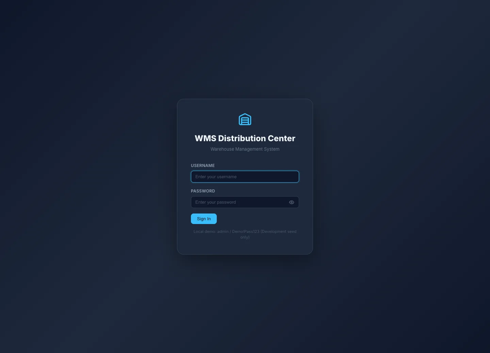 **Login** with the Demo mode panel | 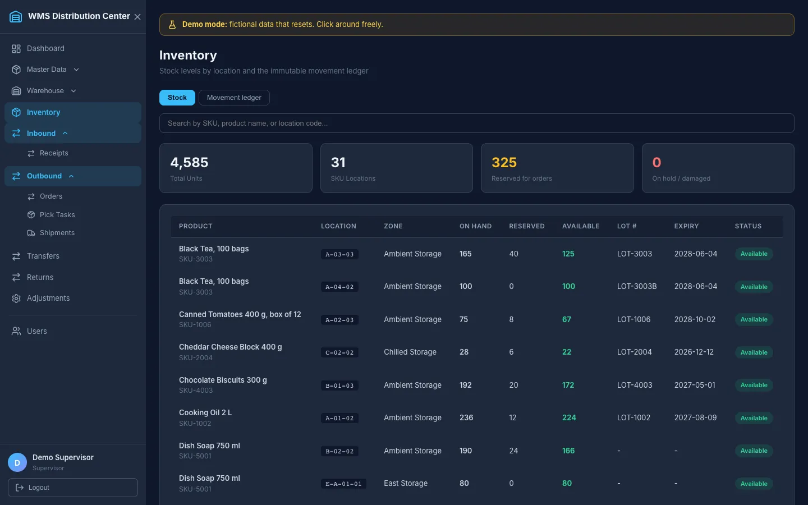 **Inventory** with reserved vs available |
| 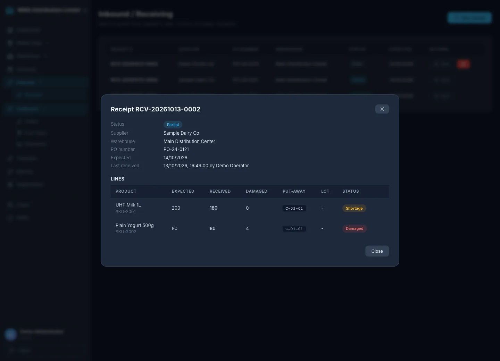 **Receipt**: partial delivery with a shortage and damaged goods | 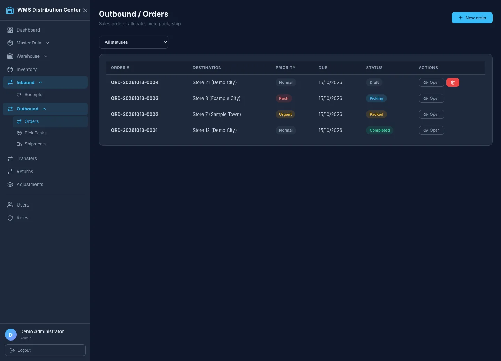 **Outbound orders** in every state |
| 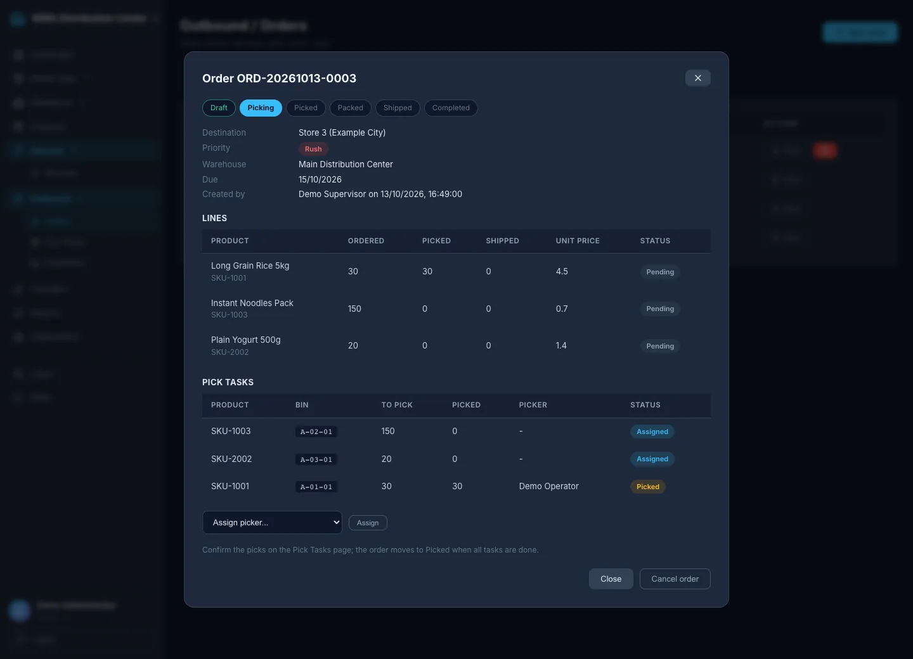 **Order in Picking**: lines, pick tasks, picker assignment | 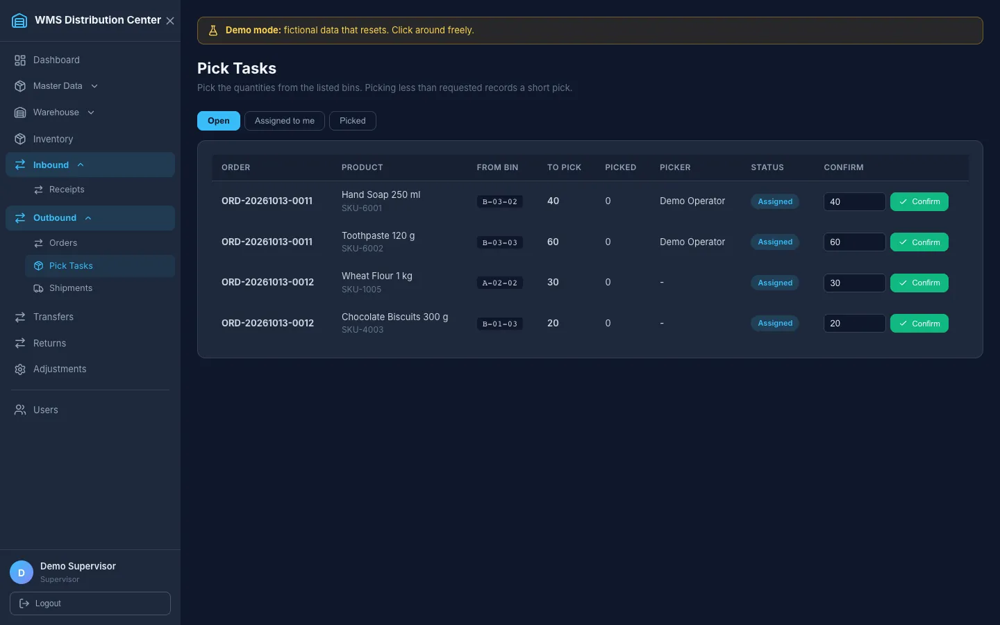 **Pick tasks**: confirm or short-pick |
| 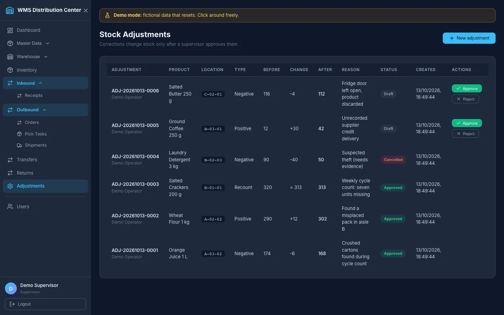 **Adjustments** awaiting approval | 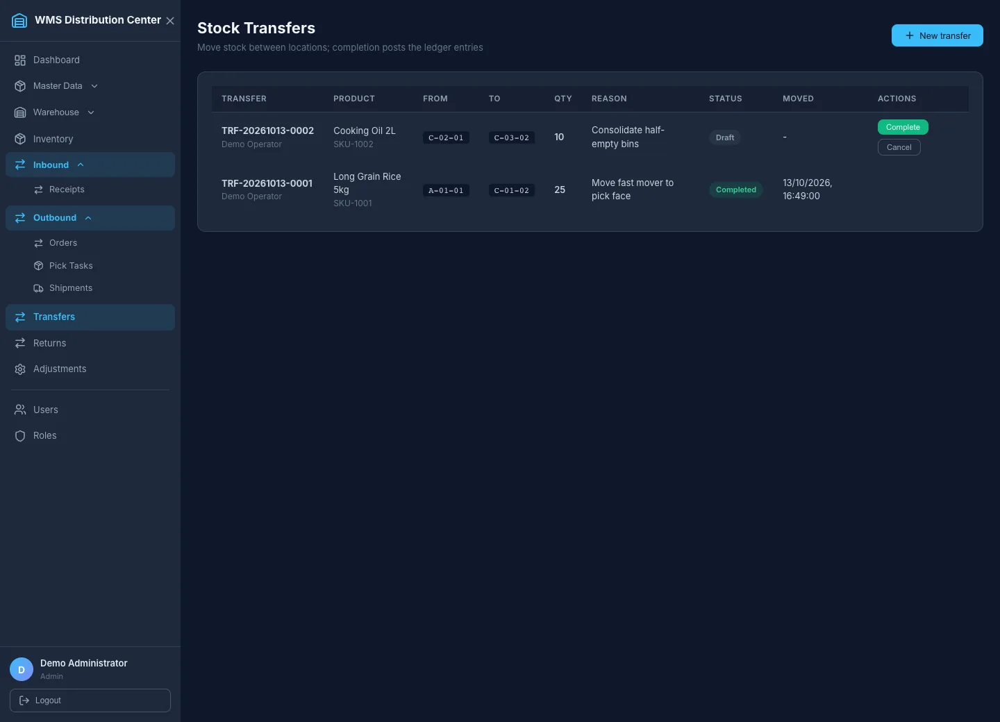 **Transfers** |
| 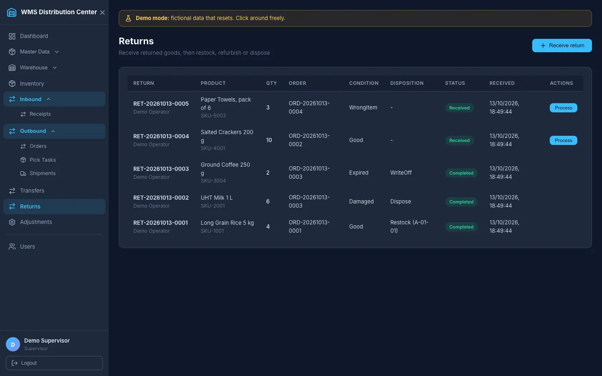 **Returns** |  **Dashboard** with the demo banner |

## Architecture

```
React 19 + Vite  --/api-->  ASP.NET Core 9 Web API  --EF Core 8-->  PostgreSQL 16
 (axios, router)            Controllers -> Services -> DbContext
                            JWT + role policies, rate limiting, Swagger (Development)
```

```
backend/    ASP.NET Core API: Controllers, Services (business rules), Mapping (explicit DTO mappers),
            Security (roles, policies, JWT settings), Data (DbContext, migrations, seeder)
contracts/  Shared JSON contracts (permission matrix, demo dataset) asserted by backend and browser-demo tests
frontend/   React SPA (src/browser-demo: the in-browser API for the static demo): pages, shared UI (modal, toasts, data states), auth context, API client,
            Vitest tests next to the code, Playwright end-to-end test in e2e/
tests/      xUnit: unit, workflow, concurrency, authorization matrix, security and migration tests
docs/       API reference, user manual, original specification, ERD, screenshots
scripts/    secret-scan.sh, demo.sh (demo without the full Docker stack), reset-demo.sh
.devcontainer/  GitHub Codespaces configuration (starts the demo)
```

Business rules live in the services behind interfaces (`InboundService`, `OutboundService`, `InventoryService`, `TransferService`, `ReturnService`); controllers only translate HTTP and apply the authorization policy.

## Tech stack

ASP.NET Core 9, Entity Framework Core 8 (Npgsql) with migrations, PostgreSQL 16, JWT bearer auth, BCrypt, Swagger/OpenAPI, React 19, Vite, React Router, Axios, Vitest + Testing Library, Playwright, xUnit, Docker, GitHub Actions. AutoMapper was removed in favour of explicit mapping (its 12.x release carries a high-severity advisory); `dotnet list package --vulnerable --include-transitive` is clean and CI fails if that changes.

## Run it locally

Prerequisites: .NET SDK 9, Node.js 22+, Docker (for the database; any PostgreSQL 16 works too).

```bash
# 1. Database: PostgreSQL 16 on localhost:5333 (throwaway local credentials)
docker compose -f docker-compose.dev.yml up -d

# 2. API -> http://localhost:5300  (Swagger UI at /swagger)
#    Development applies the EF Core migrations and seeds a fictional warehouse and the demo accounts
dotnet run --project backend

# 3. Web app -> http://localhost:5173  (proxies /api to the API)
cd frontend
npm ci
npm run dev
```

In local development, demo accounts exist **only in the Development environment with `Seed__DemoData=true`** (the default in `appsettings.Development.json`), with a small dataset: `admin`, `supervisor`, `operator`, `viewer`, all with the documented throwaway password `Demo!Pass123`. For the rich dataset, one-click login and reset use the demo options in [Try it](#try-it) instead. In Development without `Jwt__Key` the API generates a random signing key on every start (sessions end when it restarts), so no key lives in the repository.

## Run the full stack with Docker

```bash
cp .env.example .env     # then set POSTGRES_PASSWORD, JWT_KEY (openssl rand -base64 48) and ADMIN_PASSWORD
docker compose up --build
```

Web app: <http://localhost:5174>, API health: <http://localhost:5301/healthz>. Sign in as `admin` with the `ADMIN_PASSWORD` from `.env`. The stack runs in **Production mode**: Swagger is off, there are no demo accounts, migrations run on startup (`Database__MigrateOnStartup=true`), the API refuses to start with a placeholder or missing signing key, and nginx serves the SPA and proxies `/api` so no CORS is needed. Set `SEED_DEMO_DATA=true` in `.env` to also load a small fictional warehouse and products (still no demo accounts). This is the **production-style** path; for trying the app use `docker-compose.demo.yml` ([Try it](#try-it)), which is a separate file so the production compose never gets demo mode. TLS is not terminated here; put a reverse proxy in front for anything public. `docker compose down` stops it (add `--volumes` to drop the database).

## Configuration

Configuration comes from `appsettings*.json` and environment variables (`__` replaces `:`). Committed files contain no secrets.

| Setting | Notes |
|---|---|
| `ConnectionStrings__DefaultConnection` | Npgsql connection string (required outside Development) |
| `Jwt__Key` | Required outside Development: 32+ characters, rejected when it looks like a placeholder or has too little entropy. `Jwt__Issuer`, `Jwt__Audience`, `Jwt__ExpiryMinutes` (1-1440) are validated at startup |
| `AllowedOrigins__0`, `__1`, ... | Explicit CORS origins. Empty means same-origin only; `*` is rejected at startup |
| `Auth__AllowSelfRegistration` | Default `false` (`true` in Development) |
| `RateLimiting__AuthPermitLimit` / `__AuthWindowSeconds` | Login/registration limit per client address, default 10 per 60 s |
| `ForwardedHeaders__Enabled` | Set behind a reverse proxy so the limiter sees the real client address (only expose the API to the proxy) |
| `Database__MigrateOnStartup` | Apply migrations on start outside Development (Development always does) |
| `Seed__AdminUsername`, `Seed__AdminEmail`, `Seed__AdminPassword` | Creates the first administrator when no user exists (password 12+ characters) |
| `Demo__Enabled` | **Public demo mode, default `false`.** Seeds the four public accounts and the rich fictional dataset, exposes `GET /api/demo-info` as enabled and allows `POST /api/demo/reset` (Admin). Needs `Demo__Password` (8+ characters, public by design); without `Jwt__Key` it generates an ephemeral signing key. Set only by `docker-compose.demo.yml`, `scripts/demo.sh` and the devcontainer |
| `Demo__ResetPermitLimit` / `Demo__ResetWindowSeconds` | Reset budget for the whole instance, default 3 per 300 s (429 with `Retry-After` beyond it) |
| `Seed__DemoData` | Fictional warehouse, products and stock. Demo **accounts** are additionally gated on `ASPNETCORE_ENVIRONMENT=Development` |

## Database migrations

The schema is owned by EF Core migrations in `backend/Data/Migrations`. A test fails when the model drifts from the latest migration.

```bash
dotnet tool restore                                              # installs the pinned dotnet-ef
dotnet ef migrations add <Name> --project backend --output-dir Data/Migrations
dotnet ef database update --project backend                      # uses ConnectionStrings__DefaultConnection
dotnet ef migrations script --idempotent --project backend -o schema.sql   # SQL for a DBA
```

Development applies pending migrations on startup. Elsewhere the API fails fast with the command above when the schema is behind, unless `Database__MigrateOnStartup=true`.

## Tests

```bash
dotnet test WmsDistributionCenter.sln        # backend: 111 xUnit tests
cd frontend
npm run lint && npm run typecheck && npm test && npm run build    # Vitest + Testing Library (incl. the browser-demo engine)
npm run build:browser-demo && npm run check:bundle  # static demo build + bundle check
npm run test:e2e:browser-demo                # Playwright against the static browser-demo build (builds and serves it on :5176)
npm run test:e2e                             # 2 Playwright tests, needs the API and web app running (see below)
npm run test:e2e:demo                        # 5 Playwright tests against a running demo stack (E2E_BASE_URL, default :5174)
./scripts/secret-scan.sh                     # run before every push
```

- **Backend (111, incl. 4 contract tests)**: every workflow (receive, allocate, pick, pack, ship, deliver, cancel, adjust, transfer, return), over-pick and over-allocation protection, an optimistic-concurrency test and a 6-way parallel-allocation test, the authorization matrix (every endpoint x every role), JWT validation, seeding rules, CORS, rate limiting, revoked tokens, health endpoints, migration drift, and a full warehouse cycle across roles through HTTP. They use the in-memory EF provider plus the real ASP.NET pipeline.
- **Frontend (146: 102 app + 44 browser-demo)**: each page with loading, empty, error and permission states and its create/confirm flows, the generic CRUD page, login, sidebar visibility, and the permission helpers.
- **Demo mode (backend 12, frontend 8, e2e 5)**: the demo endpoint is off by default and in Production/Development/Testing profiles, creates no accounts or data when off, reset is 404 when off and 401/403/200 for anonymous/other roles/Admin, rate limited (429 + `Retry-After`), the reset restores the dataset and repairs the accounts while the admin's session stays valid, every workflow state is seeded and the stock bookkeeping is consistent, each role signs in with its own permissions, the API refuses to start in demo mode without a password; the login panel and banner only render in demo mode; Playwright covers the panel, every order state, a viewer, allocate/pick/pack, receive and reset against the real demo stack.
- **End to end (2 + 5 demo)**: one Playwright run through the browser: receive, put away, create order, allocate, pick, pack, ship, deliver, adjust, transfer, return, then check the ledger; plus a viewer who sees no actions. Locally: start the API and `npm run dev`, then `npx playwright install chromium` (or `PW_CHANNEL=chrome` to use an installed Chrome) and `npm run test:e2e`. The same test passes against the Docker stack with `E2E_BASE_URL=http://localhost:5174 E2E_DEMO_PASSWORD=<ADMIN_PASSWORD>`.
- **Browser demo**: Vitest drives the engine through the same HTTP-shaped interface the UI uses (every workflow, every endpoint x every role from `contracts/permission-matrix.json`, reset, storage versioning and migration, quota and blocked-storage handling, no network calls); backend tests assert the same two contract files (`contracts/`), so a rule or seed change on one side fails the other; Playwright runs the static build (login as each role, receive-to-ship, reload persistence, reset, no request leaves the page origin). A bundle check proves the normal build contains none of the adapter.
- **CI** (`.github/workflows/ci.yml`): backend tests and a vulnerability audit, frontend lint/test/build, the Playwright test against a real PostgreSQL service, the demo Playwright tests against `docker-compose.demo.yml` (the actual one-command path), a `browser-demo` job (engine tests, static build, bundle check, Playwright on the static files, `dist` uploaded as an artifact, never deployed), and the secret scan.

## Security

- Per-endpoint role policies (above), tokens revalidated against the user record, BCrypt hashes, a dummy hash comparison so unknown users cost the same as wrong passwords.
- Configuration validated at startup (JWT key strength, issuer/audience, expiry, CORS origins), fail fast with a clear message.
- Rate limiting on login and registration; security headers (`nosniff`, frame deny, no referrer); request validation with minimum password length 10.
- No secrets in the repository: signing keys come from the environment (or are generated in Development and in demo mode), the production Docker stack requires `.env` secrets. The **public demo password is public by design** and exists only when `Demo__Enabled=true`; the endpoint that announces demo mode returns a flag and role names, never the password, and the web app only knows the password when it is built with `VITE_DEMO_PASSWORD` (demo compose and scripts only). `scripts/secret-scan.sh` runs in CI and should be run before pushing.
- Reporting issues: open a GitHub issue; this is a portfolio project, not a supported product.

## Known limitations

- **The browser demo is a simulation** (see [The situation and your options](#the-situation-and-your-options)).
- **The demo is not a hosted service.** There is no public URL: you run it yourself (Docker, Codespaces or `scripts/demo.sh`). Do not expose a demo stack to the internet with real data or as a shared environment: the accounts and password are public and any Admin can reset everything. Reset budget is per instance (3 per 5 minutes by default), and nothing resets automatically; restarting the containers keeps the data (`down -v` wipes it).
- **No Docker-free database.** The app uses PostgreSQL (jsonb, migrations), so `scripts/demo.sh` still runs the database in Docker; there is no embedded database mode. Codespaces needs a GitHub account and its first start takes a few minutes.
- **Demo data is a snapshot in time**: documents are stamped with the moment of seeding (dates and numbers like `ORD-<today>-0001`), there are no customers as a separate entity (the order *destination* plays that role), and only one warehouse has real depth.

- **Not production hardened.** No audit trail beyond the stock ledger, no refresh tokens or password reset, the JWT lives in `localStorage` (exposed to XSS), TLS is not terminated by the compose stack, and there is no account lockout beyond the per-address rate limit.
- **Roles are fixed.** The four built-in roles carry the permissions; custom roles can only read. A user's warehouse is stored but does not restrict access. The role `Permissions` JSON column is unused.
- **Simplified warehouse model.** Allocation is all-or-nothing per order (no back-orders or partial shipments), one carton per order, one stock row per product and bin (so one lot per bin), no wave/batch picking, no multi-UOM conversion at transaction time, put-away is chosen by the user and not suggested.
- **Document numbers** (`RCV-`, `ORD-`, ...) are daily counters; two simultaneous creations can collide and one gets a 409 to retry.
- **Concurrency** is verified with the in-memory provider and an interleaved-parallel test; it has not been load-tested against PostgreSQL under real parallel traffic.
- **Receipts** cannot be cancelled through the API (draft receipts can be deleted), and lines can be added through the API but not edited or removed.
- **UI** is desktop-first: below 768 px the sidebar is hidden without a menu button. Lists are not paginated in the UI (inventory loads up to 500 rows).
- **Docs**: `docs/SRS.md` and `docs/TECHNICAL.md` are the original design documents with a status banner; the Postman collection only covers the first endpoints.

## Author

**Muhamad Septian Pamungkas**: [github.com/seppam](https://github.com/seppam)

Released under the MIT License.
